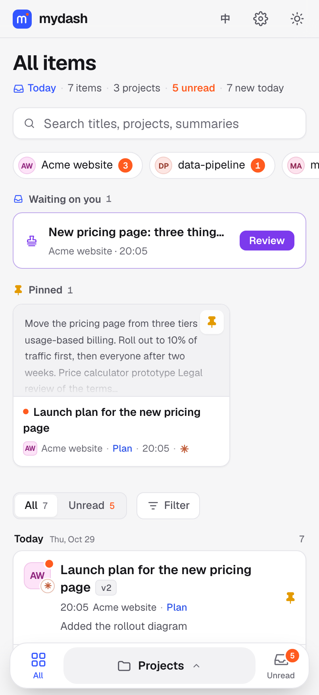
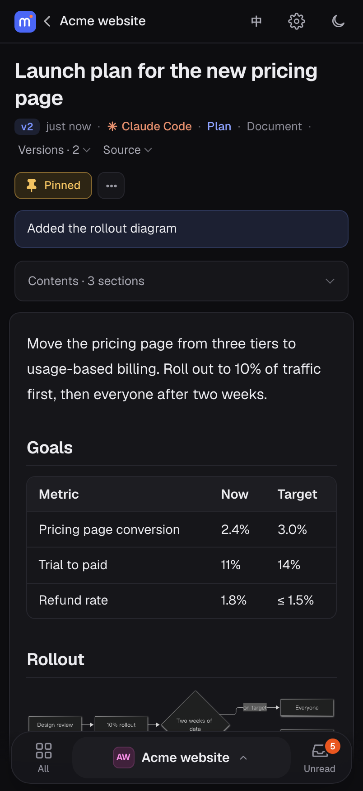
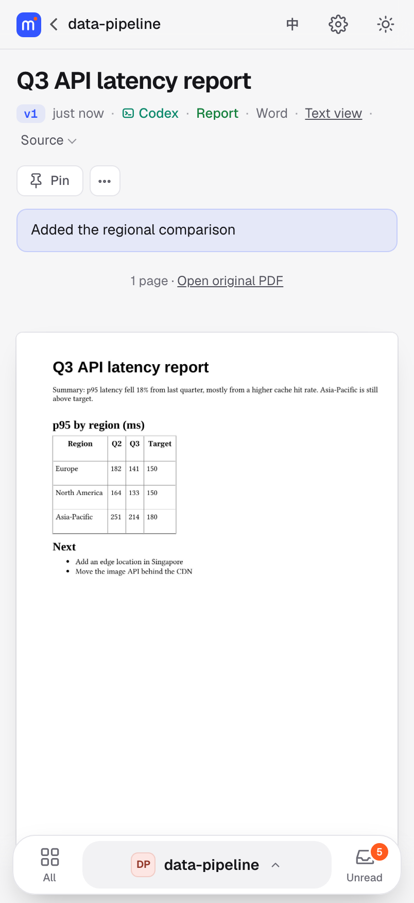
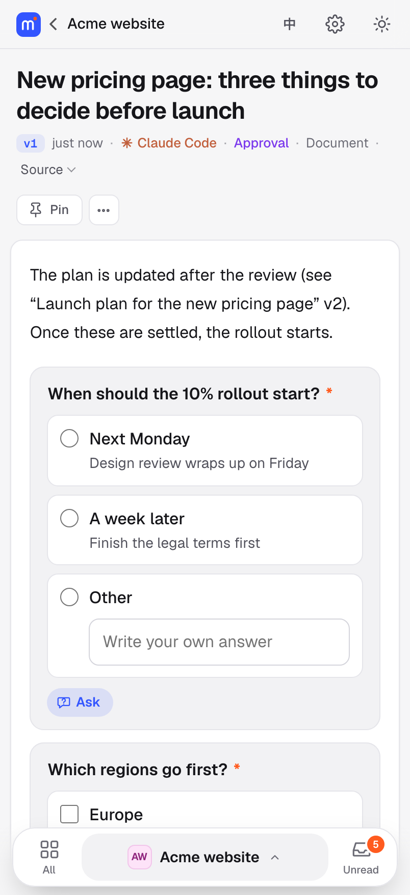
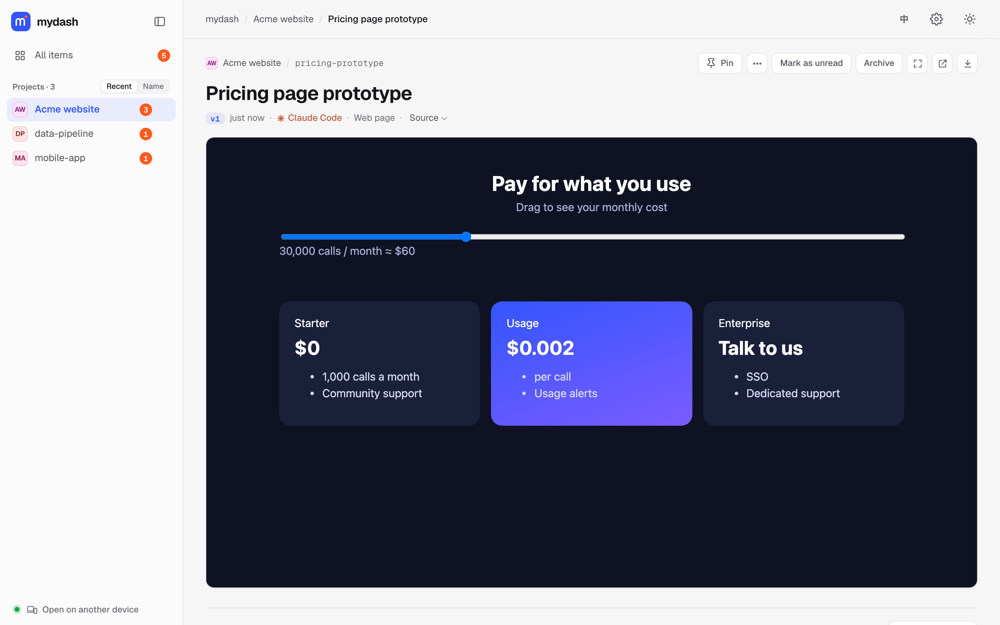
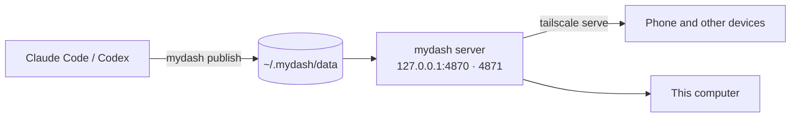

# mydash

English · [中文](README.zh-CN.md)

**A self-hosted workbench for what your coding agents make.** Claude Code and Codex write plans, reports, screenshots, PDFs, HTML prototypes and Office files all day, and leave them as file paths in a terminal. With mydash, the agent runs `mydash publish` and you get a link. The page renders the file properly on your computer or your phone, grouped by project, with versions and unread markers. Everything stays on your machine.

<p>




</p>


## Install

Your coding agent installs it. Paste this into Claude Code or Codex:

```text
Install mydash for me by following https://github.com/vanmiku/mydash/blob/main/INSTALL.md
```

The agent checks your machine and asks you a few questions: where mydash should open (only this computer, or your phone too through Tailscale), which language, and your timezone if it's on a server. Then it installs everything and gives you the link. You only step in for what needs you, such as approving a new Tailscale device or typing a `sudo` password.

**Needs:** macOS, Linux or Windows 10/11, and Node.js 20 or newer.
**Optional:** [Tailscale](https://tailscale.com) to open it from your phone anywhere (every device that opens it needs Tailscale); or `--lan on` to open it on the same Wi-Fi with an access code; LibreOffice for Word and PowerPoint previews.

<details>
<summary>Installing by hand</summary>

```bash
git clone https://github.com/vanmiku/mydash ~/.mydash/src
cd ~/.mydash/src
./setup.sh check                                   # what this machine has, and what is recommended
./setup.sh install --access tailscale --lang en    # or --access local
mydash doctor
```

`./setup.sh` with no arguments lists every option. On Windows, use `setup.cmd` in PowerShell instead of `./setup.sh`.
</details>

## What you get

- **Any format.** Markdown with contents, tables, code and Mermaid diagrams. PDFs page by page. Images, and galleries for a folder of images. HTML that runs as is. CSV and Excel tables, including GBK-encoded CSV. Word and PowerPoint as layout previews. Audio, video and source code too.
- **Projects by folder.** The project is the folder the agent session started in, detected from Claude Code and Codex session records. It stays right even after `cd` into a subfolder or inside a worktree.
- **Versions.** Publishing the same `--slug` again makes v2, v3. An open page refreshes itself, and tells you what changed since you last looked. **Compare** any two versions line by line, with the changed words marked.
- **Comments that go back to the agent.** Select a passage and comment on it, on your phone or computer. The agent runs `mydash feedback`, sees your comments with the quoted text, and marks them handled when it publishes the fix.
- **Plans, reports and the rest.** Items are sorted into plans, reports, approvals, to-dos and other, guessed from the title or set by the agent, with a filter on every list.
- **Decisions and to-dos in one place.** When an agent needs you to decide several things, it publishes an approval form: choices, multiple choice and text answers, and every choice also takes your own answer. Things only you can do arrive as a to-do list you tick off; items a command can check tick themselves. Tap **Ask** on any question or item and the agent answers right under it. Submitting wakes the agent, but only after it finishes what it is doing; if you answer in the chat instead, the form closes itself. Open forms and to-dos sit at the top under **Waiting on you**, and finished ones move to the project's records.
- **Every question your agents ask, here too.** Claude Code's choice questions, plan approvals and permission prompts show in the terminal and in mydash at the same time; answer wherever is handy and the other one closes. Codex asks its choice questions and command approvals in its own window first; if you do not answer within 30 seconds, mydash reminds you here and on your phone. Your phone is also notified when a Claude Code question waits that long. When an agent asks something in plain text at the end of a reply, it is asked once to put it as a choice question instead. Other tools can ask through `mydash ask`.
- **Not drowning in unread.** Mute a project, archive items, or let unread items older than 14 days archive themselves. A **Today** page sums up what came in.
- **Full-text search** across everything published, also from the command line (`mydash search`).
- **Notifications** on your phone when an agent publishes or waits for you: Bark, ntfy, Telegram, Pushover, team chat bots (WeCom, Feishu, DingTalk, Slack, Discord), email, or browser push over HTTPS. Add as many as you like on the settings page, even two of the same kind (say, two iPhones with Bark), each with its own name and on/off switch, plus an optional daily summary. Each kind comes with a step-by-step setup guide on the page. Only titles leave your machine.
- **Print or save as PDF** from any document, in light colours even in dark mode.
- **Back after a restart, no login needed (macOS).** With `--service launchd-boot`, mydash and its Tailscale node start at boot, before anyone logs in, so a headless Mac mini comes back after a power cut. `mydash forward 22 5900` passes SSH and Screen Sharing through that node, so you can log in to the Mac from anywhere.
- **Agents on other machines.** A cloud server's agent can publish to the mydash on your Mac with a token (`mydash remote token`); unchanged files are not uploaded twice.
- **Small on disk.** Files that did not change between versions are stored once; `mydash prune` keeps only the latest versions.
- **Made for reading on a phone.** Unread markers, pins, search, project renaming, bottom navigation on mobile, filters and less-used buttons tucked away on small screens, and dark mode that switches by time of day.
- **Chinese or English, per device.** The button at the top switches the pages on that device; the command line and notifications keep the language chosen at install.
- **You can see which tool made what.** Each item records whether Claude Code or Codex published it. Entries carry a small mark, the item page names the tool, and when more than one tool has published you can filter by tool. Other tools can label themselves with `MYDASH_AGENT`.
- **Agents that know about it.** `mydash integrate claude` and `mydash integrate codex` add two short rules, a skill, the permissions they need and the hooks that bring their questions here. Every change is marked and can be undone with `--remove`; updating mydash keeps them current.

## Why not Claude Code Artifacts?

Claude Code can [publish pages to claude.ai](https://code.claude.com/docs/en/artifacts) on its own. That is the better choice for a page you want to share. mydash is for output that is meant for you and should stay on your machine.

| | mydash | Claude Code Artifacts |
|---|---|---|
| Where files live | your machine; reachable over your tailnet if you choose | claude.ai |
| Formats | Markdown, HTML, PDF, Word, PowerPoint, Excel, CSV, images, audio, video, code | HTML and Markdown pages |
| Which agents | Claude Code and Codex (detected and labelled), anything else that can run a command | Claude Code |
| Organised by | project folder, with versions and unread state | individual artifacts |

## Security

- The server listens on `127.0.0.1`. Other devices reach it through `tailscale serve` inside your tailnet, or, with `--lan on`, on this computer's LAN addresses, where each device logs in once with an access code (rate-limited, revocable with `mydash lan reset`). Requests from public addresses are refused. Do not expose it to the internet.
- Published HTML and SVG run from a separate port (a different origin), so a page's scripts cannot call the workbench. Workbench pages carry a Content Security Policy that allows only mydash's own scripts, so script inside a Markdown or Word document never runs there. The `Host` header is checked against DNS rebinding, and write requests need a custom header, JSON and a same-origin `Origin`.
- `mydash publish` refuses `.env` files, private keys and files that contain API tokens, unless you pass `--allow-secret`.
- A to-do item can tick itself by running a command; that only happens in lists the agent explicitly published as to-dos, the command is shown on the page, and it is never run for items published from another machine.
- Pages load nothing from third parties: fonts, Mermaid and pdf.js are served locally.

## Other ways to reach it

mydash only listens on this computer (and, if you turn it on, your LAN), so anything that can forward a URL to `127.0.0.1:4870` works. Set `allowedHosts` and `contentOrigin` in `~/.mydash/config.json` to the names you use.

| Option | Good for | Note |
|---|---|---|
| Tailscale (built in) | your own devices, anywhere | no login page needed; free for personal use |
| Same Wi-Fi (built in, `--lan on`) | phones and laptops at home | access code once per device; plain HTTP on the local network |
| [ZeroTier](https://www.zerotier.com) | the closest alternative to Tailscale | also a private mesh network |
| [NetBird](https://netbird.io), or [Headscale](https://github.com/juanfont/headscale) with Tailscale apps | self-hosting the coordination server | open source |
| [Cloudflare Tunnel](https://developers.cloudflare.com/cloudflare-one/connections/connect-networks/) + Access | any browser, no app to install | needs your own domain; put Cloudflare Access login in front, and give the content port its own hostname |

## How it works



- Files are copied to `~/.mydash/data/<project>/<slug>/v<N>/`, next to a `meta.json`. They are plain files, easy to back up.
- A small Node.js server with no framework renders them. launchd (macOS), systemd (Linux) or the Startup folder (Windows) keeps it running.
- Previews are made when you publish: LibreOffice turns Office files into PDF, and PDFs become page images (CoreGraphics on macOS, `pdftoppm` on Linux).

## Commands

| Command | |
|---|---|
| `mydash publish <files or folders> --slug <id> [--title …] [--note …]` | publish; the same slug again makes a new version |
| `mydash ls [--all]` · `mydash url [project[/slug]]` | list items, print a URL |
| `mydash rm <project>/<slug> [--version N]` | delete an item or one version |
| `mydash rebuild [--agents\|--dedup\|--categories]` | add missing previews; fill in tool / type for older items; link duplicate files |
| `mydash feedback [--json]` · `mydash feedback done <id>` | the user's open comments, for the agent |
| `mydash search <words>` · `mydash prune --keep N` | search everything; keep only the latest N versions |
| `mydash ask "<question>" <options…>` | ask the user in mydash and wait for the answer (for any tool) |
| `mydash approvals [wait\|close\|done]` · `mydash todos [wait\|done]` · `mydash asks [reply]` | for the agent: answers to approval forms, to-dos, questions on items |
| `mydash notify bark\|ntfy\|telegram\|… <url>` · `mydash notify daily 21:00` | phone notifications (or the settings page) |
| `mydash remote token --name <machine>` · `mydash lan on` | let another machine publish here; open it on the same Wi-Fi |
| `sudo mydash service boot` · `sudo mydash service login` | macOS: start at boot before anyone logs in, or back to starting at login |
| `mydash forward 22 5900` · `mydash forward off` | pass SSH / Screen Sharing through mydash's own Tailscale node |
| `mydash doctor [--json]` | check that everything works, with fixes |
| `mydash integrate claude\|codex [--dry-run] [--remove] [--no-hooks]` | set up an agent to use mydash |
| `mydash update` · `mydash uninstall [--purge]` | update from git, remove |

## Status

v0.1, a personal tool shared as is. Issues and pull requests are welcome; replies may take a while. For changes to mydash itself, start with [AGENTS.md](AGENTS.md).

## License

[MIT](LICENSE). Bundled fonts and dependencies: [THIRD_PARTY_NOTICES.md](THIRD_PARTY_NOTICES.md).
