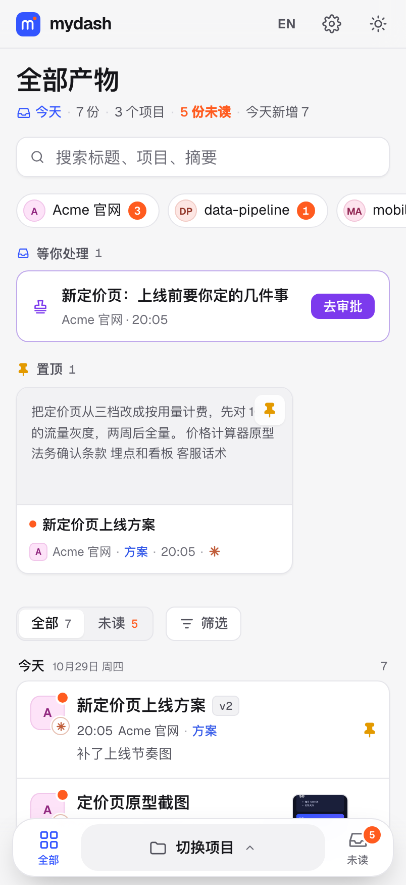
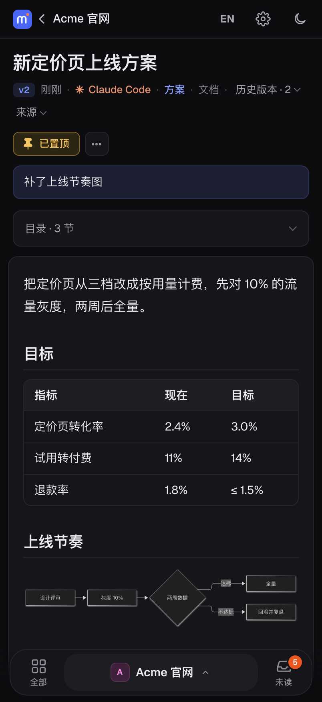
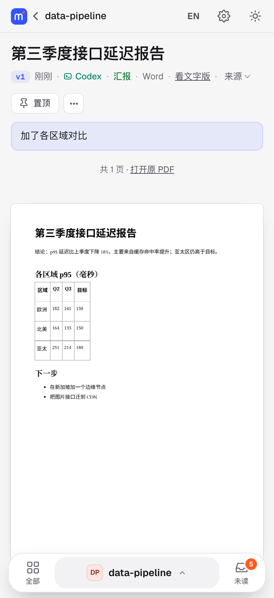
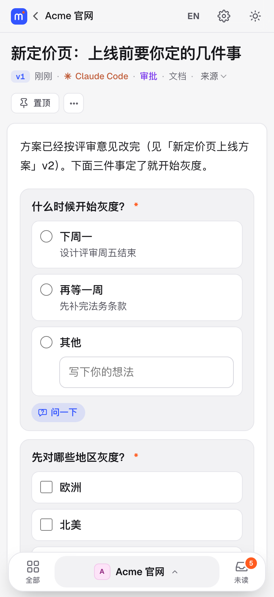
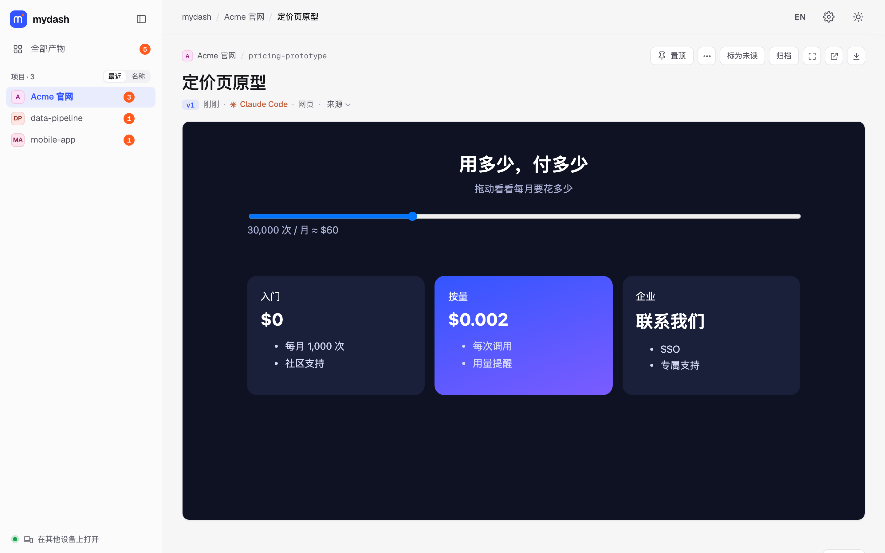
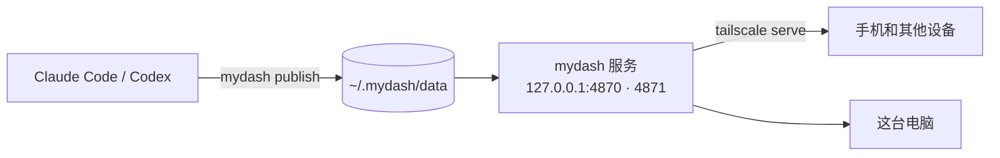

# mydash

[English](README.md) · 中文

**编程 agent 产物的自托管工作台。** Claude Code 和 Codex 每天都在写方案、报告、截图、PDF、网页原型和 Office 文件，最后只在终端里留下一串文件路径。用了 mydash，agent 运行 `mydash publish`，你就拿到一个链接，在电脑或手机上直接看排好版的内容。条目按项目归类，有版本记录和未读标记，所有东西都留在你自己的机器上。

<p>




</p>


## 安装

让你的编程 agent 来装。把下面这句话发给 Claude Code 或 Codex：

```text
帮我安装 mydash，按 https://github.com/vanmiku/mydash/blob/main/INSTALL.md 的说明来
```

agent 会先检查你的机器，问你几个问题：mydash 在哪里打开（只在这台电脑，还是手机也能通过 Tailscale 打开），网页用什么语言，装在服务器上时再问时区。然后装好并把链接给你。只有必须你本人做的事才需要你动手，比如批准一台新的 Tailscale 设备，或者输一次 `sudo` 密码。

**需要：** macOS、Linux 或 Windows 10/11，以及 Node.js 20 或更新版本。
**可选：**
- [Tailscale](https://tailscale.com)：用来在手机上随时随地打开（打开它的每台设备都要装 Tailscale）。
- `--lan on`：同一 WiFi 下的设备凭访问码打开。
- LibreOffice：用来生成 Word 和 PPT 的排版预览。

<details>
<summary>自己动手安装</summary>

```bash
git clone https://github.com/vanmiku/mydash ~/.mydash/src
cd ~/.mydash/src
./setup.sh check                                   # 看这台机器有什么、推荐怎么装
./setup.sh install --access tailscale --lang zh    # 或者 --access local
mydash doctor
```

不带参数运行 `./setup.sh` 会列出所有选项。Windows 上在 PowerShell 里用 `setup.cmd` 代替 `./setup.sh`。
</details>

## 能做什么

- **什么格式都能看。**
  - Markdown：目录、表格、代码、Mermaid 流程图。
  - PDF：逐页显示。
  - 图片：直接显示，一组图片变成画廊。
  - 网页：原样运行。
  - CSV、Excel：显示成表格，CSV 能自动识别 GBK 编码。
  - Word、PPT：显示排版预览。
  - 音频、视频、源代码也能看。
- **项目按文件夹归类。** 项目就是 agent 会话启动时所在的文件夹，从 Claude Code 和 Codex 的会话记录里读出来。中途 `cd` 到子目录、进 worktree 都不会分错。
- **版本记录和对比。** 同一个 `--slug` 再发一次就是 v2、v3。开着的页面会自己刷新，并告诉你上次看过之后改了什么。任意两个版本都能逐行对比，改了的字会标出来。
- **批注交回给 agent。** 在手机或电脑上选中一段写意见。agent 运行 `mydash feedback` 就能看到带原文引用的批注，改完发布时标记已处理。
- **按类型归类。** 条目分成方案、汇报、审批、待办、其他，按标题推断或由 agent 指定，每个列表都能按类型筛选。
- **要你拍板、动手的事放在一处。**
  - agent 要你连着定几件事时，会发一张审批单：单选、多选、填空都行，每道选择题都能写你自己的答案。
  - 只有你能做的事会变成待办清单，做完勾掉；能用命令判断的项做完会自己勾上。
  - 对任何一道题、一项待办点「问一下」，agent 会在下面回答。
  - 提交后 agent 会接着干，但会先做完手上的事；你在对话里答了，网页上那张会自己关掉。
  - 没处理的放在首页顶上的「等你处理」，处理完的进项目的「处理记录」。
- **agent 的每个提问都先到这里。**
  - Claude Code 的选择题、计划确认、权限确认，会同时出现在终端和 mydash 上，哪边方便在哪边答，另一边自动关掉。
  - Codex 的选择题和命令审批先在 Codex 软件里问；30 秒没答，mydash 和手机上会提醒你回去答。
  - Claude Code 的题 30 秒没人答，也会推送到手机。
  - agent 在回复末尾用文字问你时，会被提醒一次，改成选择题再问。
  - 别的工具可以用 `mydash ask` 问。
- **未读不会失控。**
  - 可以静音某个项目，也可以归档条目。
  - 超过 14 天没看的未读条目会自动归档。
  - 「今天」页面汇总当天收到的东西。
- **全文搜索。** 在所有发布过的内容里搜索，命令行也能用（`mydash search`）。
- **手机推送。** agent 发布了东西、或者在等你时推送到手机：Bark、ntfy、Telegram、Pushover、群机器人（企业微信、飞书、钉钉、Slack、Discord）、邮件，或者 HTTPS 下的浏览器推送。在设置页里想加几个加几个，同一种也能加两个（比如两台 iPhone 各一个 Bark），每个可以起名字、单独开关；也可以每天定点推一条摘要。每一种在页面上都附了一步步的设置教程。只有标题会离开你的机器。
- **打印 / 存成 PDF。** 任何文档都能打印，深色模式下也按浅色打印。
- **重启后不用登录就能用（macOS）。** 装的时候加 `--service launchd-boot`，mydash 和它的 Tailscale 节点开机就启动，不用等人登录：放在家里的 Mac mini 停电重启后照样能连。`mydash forward 22 5900` 让这个节点转发 SSH 和屏幕共享，在外面也能连回这台 Mac 登录。
- **其他机器上的 agent 也能发。** 云服务器上的 agent 带着令牌（`mydash remote token`），就能发到你 Mac 上的 mydash；没变的文件不会重复上传。
- **省空间。** 版本之间没变的文件只存一份；`mydash prune` 只保留最近几个版本。
- **中英文按设备切换。** 顶栏的按钮只切换这台设备上的页面；命令行和推送仍用安装时选的语言。
- **为手机阅读设计。**
  - 未读标记、置顶、搜索。
  - 小屏幕上，筛选和不常用的按钮收起来，正文更靠前。
  - 可以给项目改显示名。
  - 手机上用底部导航。
  - 深色模式按时间自动切换。
- **看得出是哪个工具发的。**
  - 每个条目都记下是 Claude Code 还是 Codex 发的。
  - 列表里每条带一个小标记，条目页写出工具全名。
  - 有两个以上的工具发过东西时，可以按工具筛选。
  - 别的工具可以用 `MYDASH_AGENT` 报上自己的名字。
- **agent 自己会用。** `mydash integrate claude` 和 `mydash integrate codex` 会写进两小段规则、一个 skill、需要的权限，以及把它们的提问带到这里的钩子。所有改动都带标记，用 `--remove` 可以原样撤销；更新 mydash 时会一起更新。

## 和 Claude Code Artifacts 有什么不同？

Claude Code 自己也能[把页面发布到 claude.ai](https://code.claude.com/docs/en/artifacts)，要分享给别人看的页面用它更合适。mydash 适合只给自己看、而且应该留在自己机器上的产物。

| | mydash | Claude Code Artifacts |
|---|---|---|
| 文件放在哪 | 你自己的机器；需要的话通过你的 tailnet 访问 | claude.ai |
| 支持的格式 | Markdown、网页、PDF、Word、PPT、Excel、CSV、图片、音视频、代码 | 网页和 Markdown |
| 哪些 agent 能用 | Claude Code 和 Codex（自动识别并标出），以及任何能运行命令的工具 | Claude Code |
| 怎么组织 | 按项目文件夹，有版本和未读状态 | 一个个独立的页面 |

## 安全

- **只在本机监听。** 其他设备有两种方式访问：
  - 通过 `tailscale serve` 在你的 tailnet 里访问。
  - 开了 `--lan on` 后从同一 WiFi 访问：每台设备第一次要输访问码；输错次数有限制，用 `mydash lan reset` 可以作废所有设备。

  公网来的请求一律拒绝。不要把它暴露到公网。
- **网页产物隔离运行。** 发布的网页和 SVG 在单独的端口（不同的源）里运行，里面的脚本碰不到工作台。工作台页面带内容安全策略（CSP），只允许 mydash 自己的脚本，Markdown、Word 文档里夹带的脚本在工作台上一律不运行。
- **防跨站攻击。** 服务会校验 `Host` 头，防 DNS 重绑定；写入请求必须带自定义头、用 JSON、来自同源的 `Origin`。
- **防误发密钥。** `mydash publish` 会拒绝发布 `.env` 文件、私钥和含有 API token 的文件，除非加 `--allow-secret`。
- **待办的自动检测有边界。** 待办项可以靠运行一条命令自动勾上，但只在 agent 明确发成待办的清单里才会跑，命令会显示在页面上，别的机器传来的一律不跑。
- **不加载第三方资源。** 字体、Mermaid 和 pdf.js 都由本地提供。

## 其他访问方式

mydash 只在本机监听（开了局域网访问后，也在局域网里监听）。所以任何能把网址转发到 `127.0.0.1:4870` 的工具都能用。用到的域名写进 `~/.mydash/config.json` 的 `allowedHosts` 和 `contentOrigin`。

| 方式 | 适合 | 说明 |
|---|---|---|
| Tailscale（内置） | 自己的设备，在哪都能打开 | 不用登录页；个人使用免费 |
| 同一 WiFi（内置，`--lan on`） | 家里的手机和电脑 | 每台设备输一次访问码；局域网里是 HTTP 明文 |
| [ZeroTier](https://www.zerotier.com) | 和 Tailscale 最像的替代 | 同样是私有组网 |
| [NetBird](https://netbird.io)，或 [Headscale](https://github.com/juanfont/headscale) 配 Tailscale 客户端 | 想自己托管协调服务器 | 开源 |
| [Cloudflare Tunnel](https://developers.cloudflare.com/cloudflare-one/connections/connect-networks/) + Access | 任何浏览器，不用装 App | 需要自己的域名；前面加 Cloudflare Access 登录；内容端口要单独一个子域名 |

## 工作原理



- **存储：** 文件复制到 `~/.mydash/data/<项目>/<slug>/v<N>/`，旁边放一份 `meta.json`。都是普通文件，方便备份。
- **服务：** 一个不依赖框架的小型 Node.js 服务负责渲染。macOS 上由 launchd、Linux 上由 systemd、Windows 上由"启动"文件夹保持运行。
- **预览：** 发布时就生成好。LibreOffice 把 Office 文件转成 PDF，PDF 再渲染成逐页图片（macOS 用 CoreGraphics，Linux 用 `pdftoppm`）。

## 命令

| 命令 | 说明 |
|---|---|
| `mydash publish <文件或目录> --slug <id> [--title …] [--note …]` | 发布；同一个 slug 再发会变成新版本 |
| `mydash ls [--all]` · `mydash url [项目[/slug]]` | 列出条目，打印网址 |
| `mydash rm <项目>/<slug> [--version N]` | 删除条目或某个版本 |
| `mydash rebuild [--agents\|--dedup\|--categories]` | 补齐预览；给旧条目补记工具、类型；重复文件改成链接 |
| `mydash feedback [--json]` · `mydash feedback done <id>` | 给 agent 看的：用户还没处理的批注 |
| `mydash search <关键词>` · `mydash prune --keep N` | 全文搜索；只保留最近 N 个版本 |
| `mydash ask "<问题>" <选项…>` | 在 mydash 上问用户，等答完再返回（任何工具都能用） |
| `mydash approvals [wait\|close\|done]` · `mydash todos [wait\|done]` · `mydash asks [reply]` | 给 agent 用的：审批单的答复、待办、用户在某一项上的提问 |
| `mydash notify bark\|ntfy\|telegram\|… <网址>` · `mydash notify daily 21:00` | 推送到手机（也可以在设置页里填） |
| `mydash remote token --name <机器>` · `mydash lan on` | 让别的机器发到这里；同一 WiFi 下打开 |
| `sudo mydash service boot` · `sudo mydash service login` | macOS：开机就启动、不用等人登录；或改回登录后启动 |
| `mydash forward 22 5900` · `mydash forward off` | 让 mydash 自己的 Tailscale 节点转发 SSH、屏幕共享 |
| `mydash doctor [--json]` | 检查是否正常，并给出修法 |
| `mydash integrate claude\|codex [--dry-run] [--remove] [--no-hooks]` | 让 agent 用上 mydash |
| `mydash update` · `mydash uninstall [--purge]` | 从 git 更新、卸载 |

## 状态

v0.1，个人工具，原样分享。欢迎提 issue 和 PR，回复可能会慢一些。想改 mydash 本身，先看 [AGENTS.md](AGENTS.md)。

## 许可证

[MIT](LICENSE)。随附的字体和依赖见 [THIRD_PARTY_NOTICES.md](THIRD_PARTY_NOTICES.md)。
