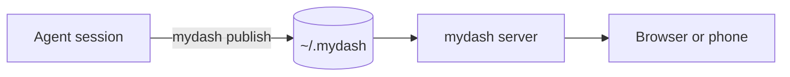

# Welcome to mydash

mydash is installed and working. This is the first item, in the **mydash** project. From now on, whatever your coding agents publish shows up on the home page, grouped by the folder each session started in.

## How it works

- Your agent runs `mydash publish <file> --slug <id>` and gives you the link.
- Publishing the same slug again adds a new version. An open page refreshes itself, and tells you what changed since you last looked.
- New items are marked unread. Pin the ones you keep coming back to.

## What it shows

| Kind | Shown as |
|---|---|
| Markdown | a document with contents, tables, code and Mermaid diagrams |
| PDF | page images, or rendered in the browser |
| Images | the picture; a folder of images becomes a gallery |
| HTML | runs as is, on its own port |
| CSV, Excel | a table |
| Word, PowerPoint | a layout preview (needs LibreOffice) |

This item also has a [sample table](table.csv) and a [small web page](page.html); switch between them with the tabs at the top.

## Try it

Ask your agent: *“Write a one-page summary of this project and publish it to mydash.”*
