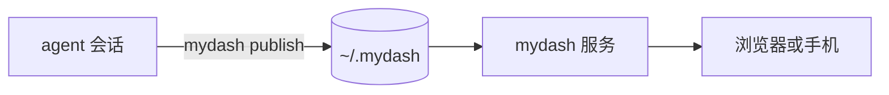

# 欢迎使用 mydash

mydash 已经装好，可以用了。这是第一条，在 **mydash** 项目里。以后编程 agent 发布的东西都会出现在首页，按每个会话启动时所在的文件夹归好类。

## 怎么用

- agent 运行 `mydash publish <文件> --slug <id>`，把链接给你。
- 同一个 slug 再发一次就是新版本。开着的页面会自己刷新，还会告诉你上次看过之后改了什么。
- 新条目标为未读。常看的可以置顶。

## 能直接看的格式

| 格式 | 怎么显示 |
|---|---|
| Markdown | 文档：目录、表格、代码、Mermaid 流程图 |
| PDF | 逐页图片，或在浏览器里渲染 |
| 图片 | 原图；一组图片变成画廊 |
| HTML | 原样运行，在单独的端口里 |
| CSV、Excel | 表格 |
| Word、PPT | 排版预览（需要 LibreOffice） |

这一条还带了一张[示例表格](table.csv)和一个[小网页](page.html)，用顶部的标签切换。

## 试一试

对你的 agent 说：*「把这个项目整理成一页简介，发到 mydash。」*
